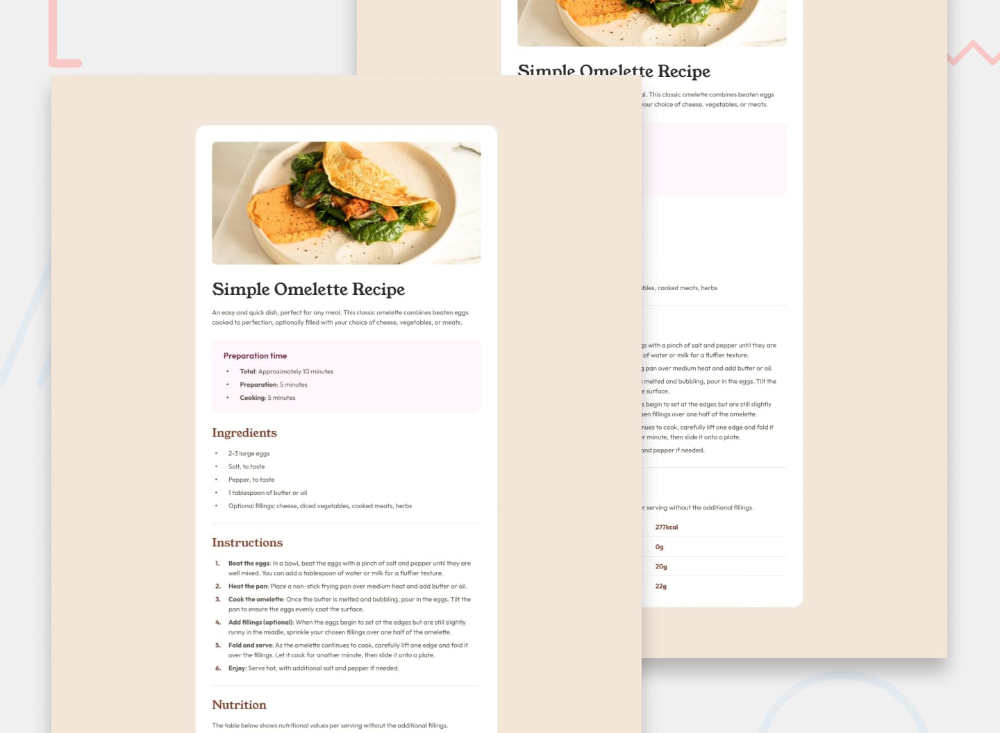

# Recipe Page



A responsive recipe page for a simple omelette, built with semantic HTML and modern CSS. This project is based on the [Frontend Mentor Recipe page challenge](https://www.frontendmentor.io/challenges/recipe-page-KiTsR8QQKm).

## Overview

The page presents:

- A featured omelette image and recipe introduction
- Preparation, cooking, and total time details
- An ingredients list
- Step-by-step cooking instructions
- Per-serving nutrition information
- A responsive layout for mobile and desktop screens

The implementation uses the challenge's design direction, including the Young Serif and Outfit typefaces, warm neutral colors, and responsive spacing.

## Built with

- Semantic HTML5
- CSS3
- CSS Flexbox
- Responsive design principles
- Google Fonts

No JavaScript, framework, package manager, or build tool is required.

## Getting started

### Prerequisites

You only need a modern web browser. A local development server is recommended so the project behaves consistently across browsers.

### Run locally

1. Clone the repository:

   ```bash
   git clone https://github.com/CodeWithMishu/recipe-page-main.git
   ```

2. Move into the project directory:

   ```bash
   cd recipe-page-main
   ```

3. Start a local server. For example, with Python:

   ```bash
   python3 -m http.server 8000
   ```

4. Open [http://localhost:8000](http://localhost:8000) in your browser.

You can also open [`index.html`](./index.html) directly, or use a static-server extension such as Live Server in Visual Studio Code.

## Project structure

```text
.
├── assets/
│   ├── fonts/              # Included font files
│   └── images/             # Recipe image and favicon
├── design/                 # Mobile and desktop reference designs
├── index.html              # Page structure and recipe content
├── style.css               # Layout, typography, and responsive styles
├── style-guide.md          # Challenge colors, typography, and layout guidance
└── preview.jpg             # Project preview image
```

## Design and responsiveness

The page is designed to adapt between the challenge's reference widths:

- Mobile: 375px
- Desktop: 1440px

When making changes, test intermediate widths as well as the reference sizes. The layout should remain readable from narrow mobile screens through large desktop displays.

## Accessibility

The page uses:

- A document language declaration
- Semantic headings and lists
- Descriptive alternative text for the recipe image
- Clear content grouping
- Readable color contrast and scalable text

When extending the page, preserve the heading hierarchy and test the layout with keyboard navigation and browser zoom.

## Deployment

This is a static website, so it can be deployed to any host that serves HTML, CSS, and image assets. Common options include:

- [GitHub Pages](https://pages.github.com/)
- [Netlify](https://www.netlify.com/)
- [Vercel](https://vercel.com/)

For a deployment, publish the repository root and use `index.html` as the entry point. No build command or environment variables are needed.

## Credits

- Challenge: [Frontend Mentor](https://www.frontendmentor.io/challenges/recipe-page-KiTsR8QQKm)
- Coded by [CodeWithMishu](https://links.codewithmishu.in/)
- Typefaces: [Young Serif](https://fonts.google.com/specimen/Young+Serif) and [Outfit](https://fonts.google.com/specimen/Outfit)

## License

The implementation code in this repository is available for learning and personal use. Challenge assets and design materials remain subject to their original licenses and the [Frontend Mentor terms](https://www.frontendmentor.io/terms).
